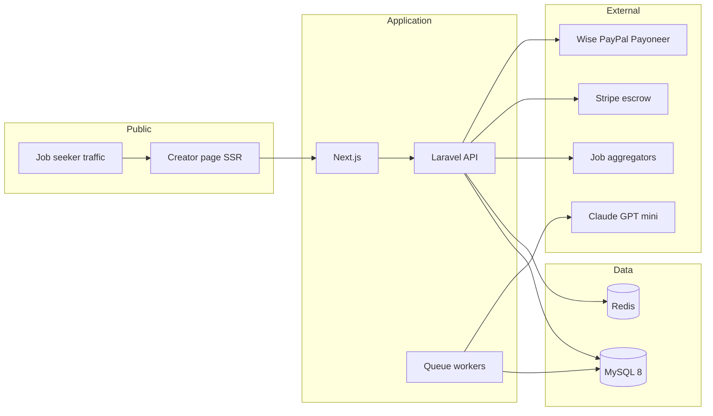

# Architecture



## Principles (blueprint)

- **Server-side tracking (D)** — not client-only JS
- **USD single ledger currency**
- **Blind matching** — employers never see creator PII in marketplace
- **Hold before pay** — pending earnings 3–7 days

## Repo

```
backend/   Laravel — tracking, ledger, matching, admin API
frontend/  Next.js — @handle pages, dashboards, employer portal
```

## Hosting (blueprint §6)

VPS → AWS later; Cloudflare CDN/WAF; SES/Resend email.

## Phase 0 API boundaries

- Creator auth + handle (A)
- Public SSR creator page (B)
- Listing ingestion (C)
- Click redirect + event log (D, PPC only)
- Fraud rules (E)
- Dashboard read (F)
- Manual payout export (I)
- Admin (L)
- GeoIP on events (P)
