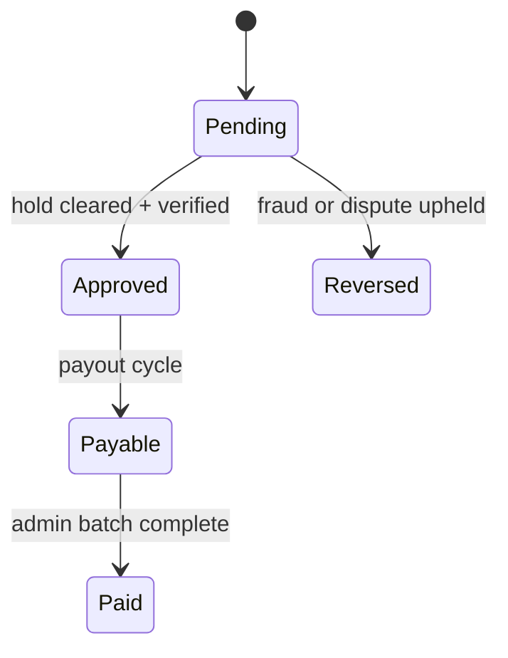

# Workflows (implemented)

See **`IMPLEMENTATION-WORKFLOW.md`** for the full guide. Below are concise flows.

## PPC click (Module D + E)

1. Visitor opens **`/r/{token}`** (Laravel `TrackingRedirectController`).
2. `ClickTrackingService` logs event; **dedup** (IP + device + link, configurable minutes).
3. If duplicate → `fraud_status=dedup`, not counted (shown in admin/creator UI).
4. If counted → PPC earning **pending** → hold → **approved** → **payable**.
5. HTTP redirect to listing `destination_url`.

## PPR registration (Phase 1)

1. Destination **`POST /api/v1/webhooks/ppr`** with secret header.
2. Email verification link → **`/ppr/verify`**.
3. Verified → earning (tier-gated).

## PPA application (Phase 3)

1. **`POST /api/v1/webhooks/ppa`** → `pending_employer`.
2. Employer **confirm/reject** on portal.
3. Employer **dispute** on confirmed → admin **Disputes** → uphold/reject.

## Earnings ledger (F / I)

## Trust tier (M)

- **Nano:** PPC
- **Micro:** + PPR
- **Mid:** + PPA, auto-payout eligible
- **Macro:** top volume (manual policy)

Promotion runs on counted clicks + active days; notifies creator (N).

## Program launch (G + H)

1. Employer creates program → **active** (if `JOBORIO_EMPLOYER_PROGRAMS_AUTO_ACTIVATE=true`).
2. Matching scores creators → **Campaigns** list.
3. Creator opt-in → tracked listing PPC/PPA uses program budget.

## Referral (J)

Signup with `?ref=` → referred earnings cross threshold → bonus + time-limited override.

## Website embed tracking (admin extension)

1. Admin creates property → embed `<script src=".../track/script/{key}.js">`.
2. External site pageviews → `website_tracking_events` (not creator PPC).

## Dispute (O)

Employer disputes PPA → creator notified → admin ruling → ledger reversal if upheld.

## Notifications (N)

`UserNotificationService` → in-app row + optional `JobOrioNotificationMail` (check `storage/logs` when `MAIL_MAILER=log`).
